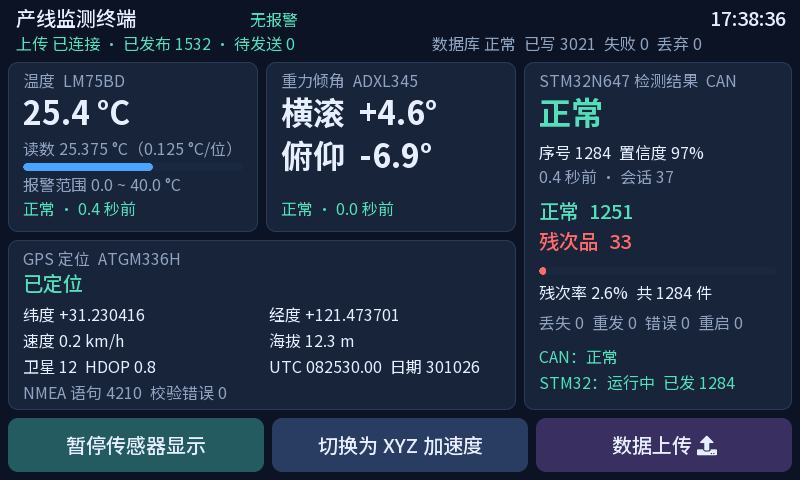
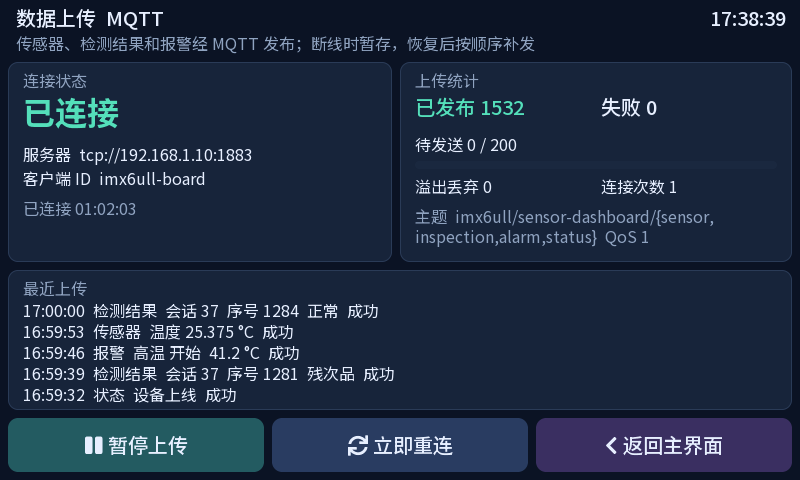

# 工业制造环境与残次品分类监测系统

基于 **i.MX6ULL Linux 网关 + STM32N647 视觉采集节点**的嵌入式监测项目。网关汇聚温度、加速度、GPS 和 CAN 产品检测结果，通过 LVGL 提供本地触摸监控，并使用 SQLite 存储数据、MQTT 上报状态与告警。

## 系统结构

```text
LM75BDP / I²C ─────┐
ADXL345 / SPI ─────┼── i.MX6ULL Linux 网关 ── LVGL / LCD / 触摸
ATGM336H / UART ───┤          ├── LED / 蜂鸣器报警
                  │          ├── SQLite 数据存储
STM32N647 ── CAN ──┘          └── MQTT 数据上报
  ├── IMX335 图像采集
  ├── LCD 实时预览与结果叠加
  └── 逐件判定、统计、心跳和结果缓存
```

## 已实现功能

### Linux 网关

- LM75BDP 温度采集、ADXL345 三轴加速度及倾角计算、ATGM336H GPS 串口数据读取与 NMEA 解析。
- I²C 温度与触摸驱动、SPI 加速度驱动、GPIO LED 与蜂鸣器驱动，以及配套板级设备树和内核配置脚本。
- 基于 framebuffer 与 evdev 的 LVGL 中文触摸界面，展示传感器数据、产品统计、节点状态和上传状态。
- SocketCAN 接收产品结果与心跳，使用启动会话号和序号去重，统计丢失、重发与节点重启，检测心跳超时。
- 基于线程邮箱的数据分发；温度上下限、回差和残次品报警；SQLite 记录传感器、检测结果与报警事件。
- 基于 Eclipse Paho 的 MQTT 发布、状态同步、遗嘱消息、断线重连、内存队列补发及上传控制。
- Linux 内核、外部模块、应用和设备树的构建与部署，以及 BusyBox 启动脚本集成。

### STM32 节点

- IMX335 摄像头 DCMIPP 双管线采集、三缓冲识别输入、LTDC 显示与 DMA2D 画面处理。
- 接收空场、正常、残次品三类概率的逐件判定状态机，支持残次品锁定、低置信度保守判定及 REVIEW 计数。
- FDCAN3 经典 CAN 500 kbit/s 通信、RNG 启动会话号、周期心跳、128 件 RAM 结果缓存与恢复后按序补发。
- LCD 产品统计、串口诊断、摄像头与模型超时故障处理。
- Simulation 与 SimulationFlash 联调配置：以可重复的模拟分类概率驱动产品状态机和 CAN 上报。

## 目录

| 目录 | 内容 |
|---|---|
| [sensor_dashboard](sensor_dashboard/) | Linux 网关应用、驱动、设备树、依赖库及部署脚本 |
| [stm32](stm32/) | STM32CubeIDE 应用、FSBL、板级驱动、中间件与构建工具 |
| [sensor_dashboard/tests](sensor_dashboard/tests/) | 解析、报警、数据库、MQTT、界面和安装测试 |
| [stm32/tests](stm32/tests/) | 产品状态机、CAN 后端和摄像头缓冲测试 |

## 构建与运行

### i.MX6ULL 网关

在 Linux 环境中准备 ARM 交叉工具链、板卡配套 Linux 4.1.15 内核源码及已有板级 `.config`：

```sh
cd sensor_dashboard
make -j4 KDIR=/path/to/linux-kernel CROSS_COMPILE=arm-linux-gnueabihf-
make dtbs KDIR=/path/to/linux-kernel
make install KDIR=/path/to/linux-kernel DESTDIR=/path/to/rootfs TFTP_DIR=/path/to/tftpboot
```

安装脚本将内核、设备树、模块、应用和启动配置安装到指定目录。开发板使用对应 zImage、DTB 和根文件系统启动。

```sh
/etc/init.d/S99sensor-dashboard start
```

配置文件为 `/etc/default/sensor-dashboard`。设置 `MQTT_HOST`、端口和认证信息后启用 MQTT 上报；默认 CAN 接口为 `can0`，速率为 500 kbit/s。详细接线及参数见 [网关说明](sensor_dashboard/README.md)。

### STM32 节点

用 STM32CubeIDE 导入以下目录中的应用与 FSBL 工程：

```text
stm32/SoftwarePackage/Projects/99_Applications/996_AI_Product_Inspection/STM32CubeIDE
```

CAN 联调选择 `Simulation`（SRAM 调试）或 `SimulationFlash`（外部 Flash 启动）配置。命令行构建、启动镜像生成和烧录地址见 [STM32 说明](stm32/README.md)。

两板使用 CANH、CANL 和公共地连接，两端配置 120 Ω 终端电阻。结果帧 ID 为 `0x210`，心跳帧 ID 为 `0x211`，均为 8 字节标准数据帧。报文字段见 [CAN 协议](stm32/docs/CAN_PROTOCOL.md)。

## 界面预览

以下为界面测试渲染图，数值为测试数据。





## 测试入口

Linux 网关主机测试：

```sh
cd sensor_dashboard
make test
sh tests/test-install.sh
```

STM32 主机测试（需要 GCC）：

```sh
cd stm32
python tools/run_host_tests.py --cc /path/to/gcc
```

## 第三方组件

工程保留 LVGL、SQLite、Eclipse Paho、STM32 HAL/CMSIS 及相关中间件的源码、版权声明和随附许可。各组件按其原始许可使用，来源见 [网关依赖说明](sensor_dashboard/docs/SOURCES.md) 与相应组件目录。
